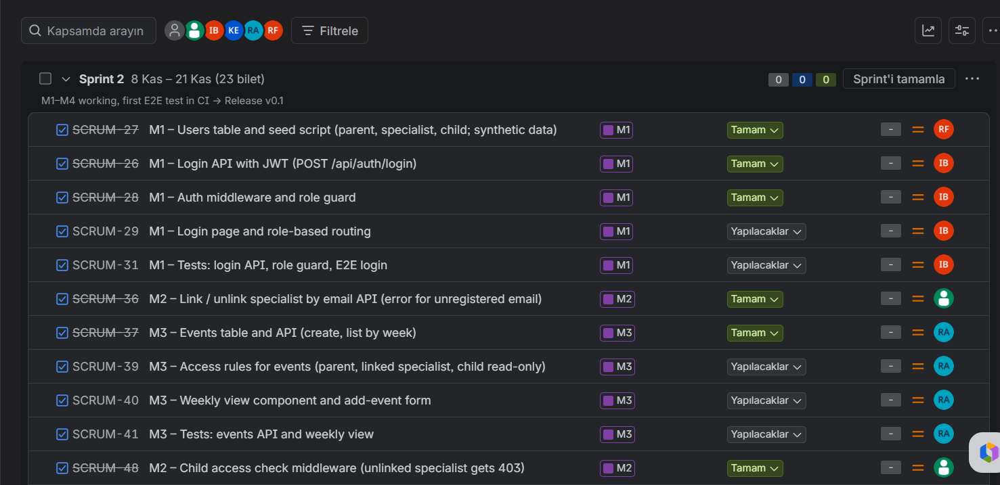
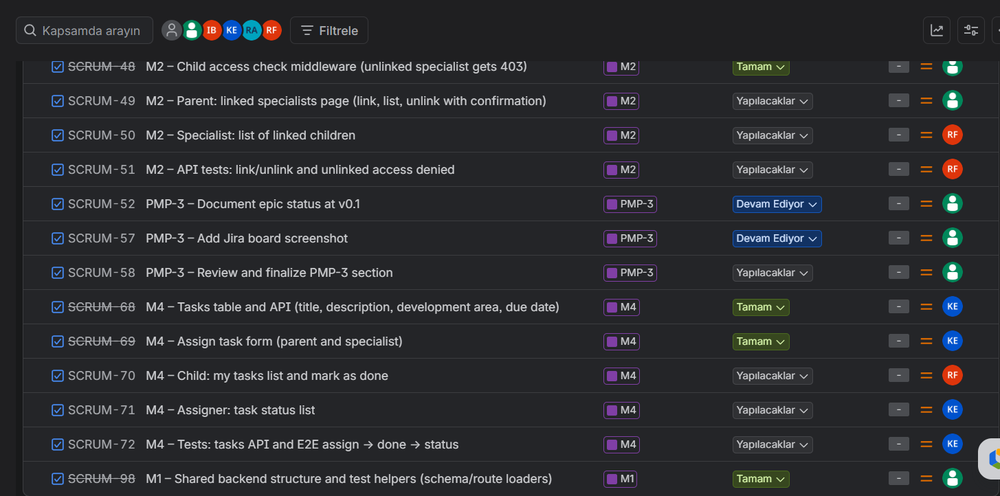

# Project Management Plan (PMP)

**Team:** Serpent (Group 11, Section 1)  
**Last updated:** 2026-11-15

| Section | Content | Required by | Status |
|---|---|---|---|
| PMP-1 | Project, Jira setup, team and roles | Week 5 | Done |
| PMP-2 | Work packages (epics) and sprint plan | Week 5 / 6 | Done |
| PMP-3 | Progress review: mid-term (v0.1) | Week 7 | Done (status as of 15 Nov; updated at v0.1) |
| PMP-4 | Progress review: v0.2 | Week 9 | Not started |
| PMP-5 | Progress review: final (v1.0) | Week 11 | Not started |
| PMP-6 | Retrospective | Week 12 | Not started |

---

## PMP-1. Project and Team

### Project and Jira Setup

**Project in one sentence:** A web-based decision support platform where parents and the specialists they link (teachers, psychologists, doctors, coaches) share one schedule, task list and observation record for a child, with an AI summary that supports, but never makes, decisions.  
**Jira project key:** SCRUM  
**Jira board link:** https://serpent0seng383.atlassian.net/jira/software/projects/SCRUM/boards/1  
**GitHub repository:** https://github.com/ygiray/Serpent  
**CI pipeline:** https://github.com/ygiray/Serpent/actions

### Team and Roles

| Name | Jira / GitHub username | Role |
|---|---|---|
| Yusuf Giray Çakıcı | ygiray | Project Manager and developer (full stack): Jira board, PMP; owner of M2 |
| İlker Bulut | ilkerbdev | Developer (full stack), team contact person; owner of M1 |
| Kerem Elmacı | keremelmaci | Developer (full stack); owner of M4, M5 |
| Rahman Ateş | rahmanats10 | Developer (full stack); owner of M3, M8 |
| Rasül Hakan Fidan | RHF29 | Tester and developer (full stack): test planning, weekly meeting notes; owner of M6, M7 |

### Working Agreements

- Every task has exactly one assignee and belongs to one epic.
- Commit messages and branch names start with the Jira key, e.g. `SCRUM-12 Add login API`, branch `SCRUM-12-login-api`.
- All changes go to `main` through a pull request reviewed by at least one other member.
- A task is **Done** only when its pull request is merged into `main`.
- Weekly team meeting; notes are committed to `docs/meetings/`.
- Every member owns at least one module and writes its requirements (SRS), design part (SDD), code and tests.

---

## PMP-2. Plan

### Work Packages (Epics)

| Epic | Owner | Number of tasks | Planned sprint(s) |
|---|---|---|---|
| M1 – Login and roles | İlker Bulut | 9 | Sprint 1, 2, 4 |
| M2 – Linking specialists | Yusuf Giray Çakıcı | 6 | Sprint 2, 4 |
| M3 – Weekly schedule | Rahman Ateş | 5 | Sprint 2, 4 |
| M4 – Tasks | Kerem Elmacı | 6 | Sprint 2, 4 |
| M5 – Specialist entries | Kerem Elmacı | 5 | Sprint 3, 4 |
| M6 – Documents | Rasül Hakan Fidan | 5 | Sprint 3, 4 |
| M7 – Weekly statistics | Rasül Hakan Fidan | 4 | Sprint 3, 4 |
| M8 – Role-based AI summary | Rahman Ateş | 6 | Sprint 3, 4 |
| SRS – Requirements specification | Yusuf Giray Çakıcı | 5 | Sprint 1 |
| DESIGN – Software design document | Yusuf Giray Çakıcı | 5 | Sprint 1 |
| PMP-1 … PMP-6 | Yusuf Giray Çakıcı | 3 each | Sprint 1 (PMP-1, 2), 2 (PMP-3), 3 (PMP-4), 4 (PMP-5, 6) |

### Sprint Plan

Two-week sprints aligned with the course schedule.

| Sprint | Weeks | Sprint goal | Ends with |
|---|---|---|---|
| Sprint 1 | Week 5–6 (24 Oct – 7 Nov) | Set up repo, CI and a walking skeleton (React → Express → SQLite); write SRS and SDD | Walking skeleton (v0.0), Week 5; SRS + SDD, Week 6 |
| Sprint 2 | Week 7–8 (8 Nov – 21 Nov) | Login with roles, linking specialists, weekly schedule and tasks (M1–M4); first E2E test in CI | Release v0.1, mid-term (Week 8) |
| Sprint 3 | Week 9–10 (22 Nov – 5 Dec) | Specialist entries, documents, weekly statistics and AI summary (M5–M8); branch coverage ≥ 40%; E2E tests for 3 critical flows | Release v0.2, Week 10 |
| Sprint 4 | Week 11–12 (6 Dec – 19 Dec) | Fix bugs found in testing, E2E test for each of M1–M8, branch coverage ≥ 60%, final report and demo | Release v1.0, final (Week 12) |

---

## PMP-3. Progress Review: Mid-term (v0.1)

**Status as of:** 2026-11-15 (end of Week 7, middle of Sprint 2). This table will be updated when v0.1 is released (2026-11-21).

**Jira board screenshot:**

**Sprint 2 in numbers:** 23 tasks – 9 Done, 14 To Do. The backend of M1–M4 is in `main` (50 backend tests and 20 frontend tests, backend branch coverage 74 %); frontend pages and the first E2E test are planned for Week 8.

| Epic | Planned for this point | Status (Done / In progress / Not started) |
|---|---|---|
| SRS | SRS final version (Week 6) | Done |
| DESIGN | SDD final version (Week 6) | Done |
| PMP-1, PMP-2 | Project, team, epics and sprint plan | Done |
| PMP-3 | Mid-term progress review | Done (this section; updated at v0.1) |
| M1 – Login and roles | Users table and seed, login API with JWT, auth middleware, login page, tests and E2E login test | In progress – backend done (SCRUM-26, 27, 28, 98); login page (SCRUM-29) and tests/E2E (SCRUM-31) in Week 8 |
| M2 – Linking specialists | Link/unlink API, child access check, linked specialists page, specialist's children list, API tests | In progress – API and access check done (SCRUM-36, 48); pages and API tests (SCRUM-49, 50, 51) in Week 8 |
| M3 – Weekly schedule | Events API, access rules, weekly view, tests | In progress – events API done (SCRUM-37); access rules, weekly view and tests (SCRUM-39, 40, 41) in Week 8 |
| M4 – Tasks | Tasks API, assign task form, child's task list, assigner's status list, tests and E2E test | In progress – tasks API and assign form done (SCRUM-68, 69); lists and tests (SCRUM-70, 71, 72) in Week 8 |
| M5 – Specialist entries | Planned for Sprint 3 | Not started (as planned) |
| M6 – Documents | Planned for Sprint 3 | Not started (as planned) |
| M7 – Weekly statistics | Planned for Sprint 3 | Not started (as planned) |
| M8 – Role-based AI summary | Planned for Sprint 3 | Not started (as planned) |

**Changes to the plan (if any):**

1. **Sprint 1 → Sprint 1b.** Sprint 1 was closed early in Jira by mistake. Its open SRS and DESIGN tasks were moved to a new Sprint 1b, which ended on 2026-11-08 with both documents delivered.
2. **M7 owner changed.** M7 (Weekly statistics) moved from İlker Bulut to Rasül Hakan Fidan to balance the workload; the PMP-2 table and Jira were updated.
3. **Late deliveries in Sprint 1.** PMP-2 and the walking skeleton (v0.0) were delivered later than planned (Week 5).
4. **Workload balanced inside Sprint 2.** Every member does backend and frontend work in every sprint. Because no M6/M7 work is planned in Sprint 2, four Sprint 2 tasks were reassigned to Rasül Hakan Fidan at sprint planning (SCRUM-27, 50, 51, 70). The module–sprint plan in PMP-2 is unchanged; tasks will be rebalanced the same way in Sprint 3.
5. **New task for a shared backend structure (SCRUM-98).** To avoid merge conflicts when five members add tables and routes at the same time, each module now adds its own files (`server/src/schema/*.sql`, `server/src/routes/*.js`), which the app loads automatically; shared test helpers were added at the same time.
6. **Week 7 milestones slipped by one to two days.** The backend of M1–M4 was planned to be in `main` by 2026-11-14 and was merged on 2026-11-15. One pull request (#18) waited five days for review. Since then the project manager checks open pull requests every day.
7. **Process changes.** `main` is protected (pull request, one approval and passing CI required). The weekly team meeting is fixed to Sundays at 20:00.

---

## PMP-4. Progress Review: v0.2

**Jira board screenshot:**  

| Epic | Planned for this point | Status (Done / In progress / Not started) |
|---|---|---|
| | | |

**Changes to the plan (if any):**

---

## PMP-5. Progress Review: Final (v1.0)

**Jira board screenshot:**  

| Epic | Planned for this point | Status (Done / In progress / Not started) |
|---|---|---|
| | | |

**Changes to the plan (if any):**

---

## PMP-6. Retrospective

- What worked well in using Jira:
- What we would do differently:
