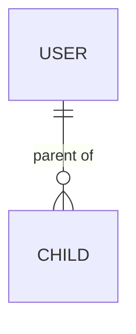

# Software Design Document (SDD)

**Team name:** Serpent (Group 11)  
**Version:** ☒ First version (Week 6) ☐ Final (Week 10)  
**Last updated:** 2026-11-06

> **How to fill in this file (delete this note before the final version)**
> - Each section has an **Owner** line. Edit only your own section, in your own branch (`SCRUM-xx-...`), and open a PR with Giray as reviewer. Deadline: **Saturday 7 November, 20:00**.
> - Use the requirement IDs from `docs/SRS.md` (e.g. `FR-M4-02`) and the entity and endpoint conventions in Sections 3 and 4, so that the SRS, ER diagram, API list and sequence diagrams match.
> - Diagrams are written in Mermaid (renders on GitHub). Images go to `docs/img/`.

---

## 1. Architecture Overview

**Owner:** Giray (SCRUM-47)

Serpent is a client–server web application. A React single-page application in the browser talks to an Express REST API over HTTP with JSON. The backend is layered: routes receive requests, middleware checks the JWT and the user's access to the requested child, services apply the business rules, and a data-access layer reads and writes a single SQLite database file. The AI summary is produced by one backend module that either calls the Gemini API or, in mock mode, returns a fixed response; the frontend never calls the AI provider directly. Everything runs locally by following the README; there is no cloud deployment.

**Main design decisions**

- **Access control in the backend.** Hiding a button is not enough. Every request about a child goes through one shared middleware that checks the current parent / linked-specialist / child relation in the database, not only the role in the token (FR-M2-05, NFR-02).
- **One AI module with a mock.** `AI_MODE=mock` (default in tests and CI) returns a fixed summary without a network call; `AI_MODE=gemini` calls the Gemini API with a key from `server/.env`, which is never committed (NFR-04).
- **The AI only sees allowed data.** The backend selects the records the requesting user may see for the chosen week and sends only those, with a role-specific prompt (parent or specialist) (NFR-03).
- **Testable app.** The Express app is created by `createApp(db)` so tests can pass an in-memory SQLite database (already used by the walking skeleton).

### Technology Stack

| Layer | Technology |
|---|---|
| Frontend | React 18, Vite 5, React Router (planned) |
| Backend | Node.js 22, Express 5 |
| Database | SQLite via better-sqlite3; synthetic data from a seed script |
| Authentication | JWT (jsonwebtoken), passwords hashed with bcrypt (planned, Sprint 2) |
| AI | Gemini API through a single backend module, with a mandatory mock mode |
| Testing | Jest + Supertest (backend unit and API tests), Vitest + React Testing Library (frontend), Playwright (end-to-end, from Sprint 2) |
| CI | GitHub Actions: backend tests, frontend tests and build on every push and pull request |

---

## 2. Module Design

**Owner:** each module owner fills in their own row (same people as the SRS). Name the main frontend pages, backend routes/services and tables.

| Module | Main components | Implements requirements |
|---|---|---|
| M1 | | FR-M1-01, … |
| M2 | Frontend: `LinkedSpecialistsPage` (parent), `MyChildrenPage` (specialist). Backend: `routes/links.js`, `services/linkService.js`, shared middleware `requireChildAccess` used by all child endpoints. Table: `specialist_links`. | FR-M2-01 … FR-M2-08 |
| M3 | | |
| M4 | | |
| M5 | | |
| M6 | | |
| M7 | | |
| M8 | | |

---

## 3. Data Model

**Owner:** İlker (SCRUM-42)

> Use these entity names (tables are the plural snake_case form, e.g. `specialist_links`). Add the fields and relationships, and draw the ER diagram in Mermaid.
>
> | Entity | Meaning |
> |---|---|
> | User | Account with email, password hash and role (`parent`, `specialist`, `child`) |
> | Child | A child's profile; belongs to one parent; may be linked to one child User account |
> | SpecialistLink | Link between a specialist User and a Child, with specialist type |
> | Event | Weekly schedule item for a child (M3) |
> | Task | Task for a child, with development area, due date, status and assigner (M4) |
> | Entry | Dated specialist observation about a child, with an edited flag (M5) |
> | Document | Uploaded PDF or image about a child (M6) |
> | AiSummary | A generated weekly summary, with role, week and source record references (M8) |

---

## 4. API / Interfaces

**Owner:** Kerem (SCRUM-67)

> Conventions (use them so the API matches the ER diagram and the sequence diagrams):
> - Base path `/api`. Login: `POST /api/auth/login`. Everything about a child is under `/api/children/:childId/...` (e.g. `GET /api/children/:childId/tasks`).
> - JSON field names in camelCase (`childId`, `developmentArea`, `dueDate`).
> - The JWT is sent as `Authorization: Bearer <token>`.
> - Errors return `{ "error": "message" }` with 400 (invalid data), 401 (no or invalid token), 403 (no access to this child), 404 (not found).
> - **Please add the endpoints of the three critical flows first (by Saturday 12:00):** Rahman needs them for the sequence diagrams.

| Method | Endpoint | Description | Module |
|---|---|---|---|
| GET | `/api/health` | Health check (walking skeleton) | – |

---

## 5. Critical Flows

**Owner:** Rahman (SCRUM-81). Same three flows as SRS Section 4; one sequence diagram each, using the endpoints from Section 4.

### Flow 1: Login and role-based screens

### Flow 2: Parent links and unlinks a specialist; an unlinked specialist is denied access

### Flow 3: Specialist assigns a task, the child marks it done, the specialist sees the status

---

## 6. User Interface

**Owner:** Rasül (SCRUM-83). Save images in `docs/img/` (hand-drawn wireframes are fine).

| Screen | Image | Module |
|---|---|---|
| | `docs/img/…` | |

---

## 7. Change Log

| Date | Change | By |
|---|---|---|
| 2026-11-06 | First version: skeleton, architecture overview, technology stack, M2 module design | Giray |
