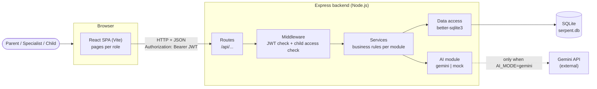
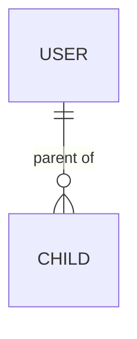
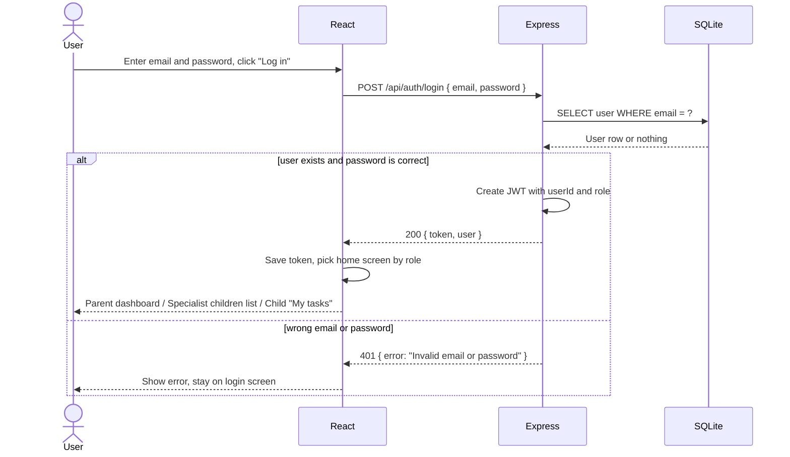
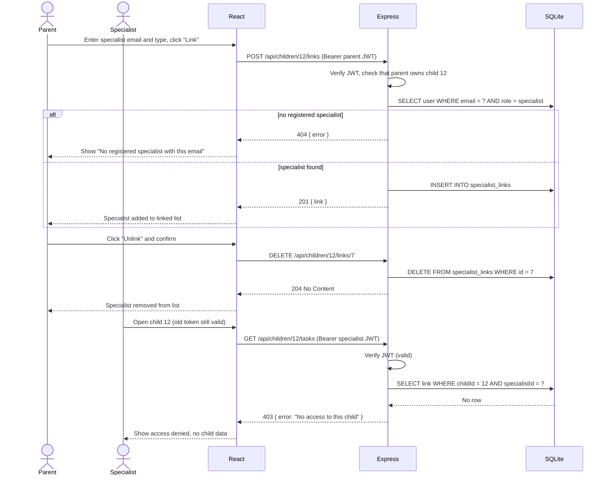
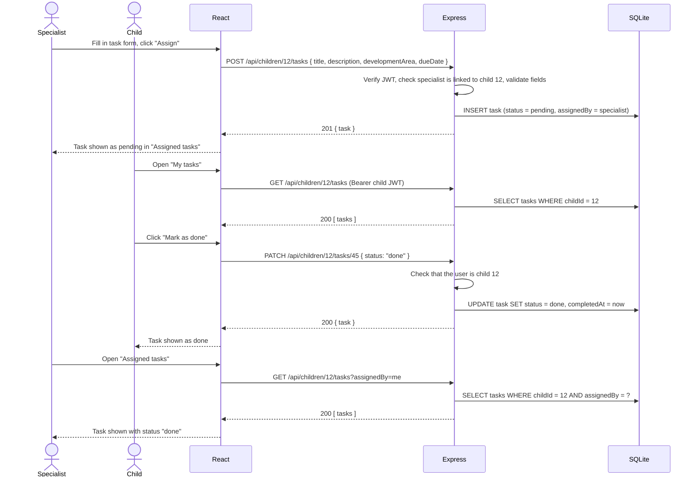

# Software Design Document (SDD)

**Team name:** Serpent (Group 11)  
**Version:** ☒ First version (Week 6) ☐ Final (Week 10)  
**Last updated:** 2026-11-06

> **How to fill in this file (delete this note before the final version)**
> - Each section has an **Owner** line. Edit only your own section, in your own branch (`SCRUM-xx-...`), and open a PR with Giray as reviewer. Deadline: **Saturday 7 November, 20:00**.
> - Use the requirement IDs from `docs/SRS.md` (e.g. `FR-M4-02`) and the entity and endpoint conventions in Sections 3 and 4, so that the SRS, ER diagram, API list and sequence diagrams match.
> - Diagrams are written in Mermaid (renders on GitHub). Images go to `docs/img/`.

---

## 1. Architecture Overview

**Owner:** Giray (SCRUM-47)

Serpent is a client–server web application. A React single-page application in the browser talks to an Express REST API over HTTP with JSON. The backend is layered: routes receive requests, middleware checks the JWT and the user's access to the requested child, services apply the business rules, and a data-access layer reads and writes a single SQLite database file. The AI summary is produced by one backend module that either calls the Gemini API or, in mock mode, returns a fixed response; the frontend never calls the AI provider directly. Everything runs locally by following the README; there is no cloud deployment.

**Main design decisions**

- **Access control in the backend.** Hiding a button is not enough. Every request about a child goes through one shared middleware that checks the current parent / linked-specialist / child relation in the database, not only the role in the token (FR-M2-05, NFR-02).
- **One AI module with a mock.** `AI_MODE=mock` (default in tests and CI) returns a fixed summary without a network call; `AI_MODE=gemini` calls the Gemini API with a key from `server/.env`, which is never committed (NFR-04).
- **The AI only sees allowed data.** The backend selects the records the requesting user may see for the chosen week and sends only those, with a role-specific prompt (parent or specialist) (NFR-03).
- **Testable app.** The Express app is created by `createApp(db)` so tests can pass an in-memory SQLite database (already used by the walking skeleton).

### Technology Stack

| Layer | Technology |
|---|---|
| Frontend | React 18, Vite 5, React Router (planned) |
| Backend | Node.js 22, Express 5 |
| Database | SQLite via better-sqlite3; synthetic data from a seed script |
| Authentication | JWT (jsonwebtoken), passwords hashed with bcrypt (planned, Sprint 2) |
| AI | Gemini API through a single backend module, with a mandatory mock mode |
| Testing | Jest + Supertest (backend unit and API tests), Vitest + React Testing Library (frontend), Playwright (end-to-end, from Sprint 2) |
| CI | GitHub Actions: backend tests, frontend tests and build on every push and pull request |

---

## 2. Module Design

**Owner:** each module owner fills in their own row (same people as the SRS). Name the main frontend pages, backend routes/services and tables.

| Module | Main components | Implements requirements |
|---|---|---|
| M1 | | FR-M1-01, … |
| M2 | Frontend: `LinkedSpecialistsPage` (parent), `MyChildrenPage` (specialist). Backend: `routes/links.js`, `services/linkService.js`, shared middleware `requireChildAccess` used by all child endpoints. Table: `specialist_links`. | FR-M2-01 … FR-M2-08 |
| M3 | Frontend: `WeeklySchedule` component (shared by parent, specialist and child screens), `EventForm`. Backend: `routes/events.js`, `services/eventService.js` (filters events by week, checks that the end time is after the start time). Table: `events`. | FR-M3-01 … FR-M3-07 |
| M4 | Frontend: `TaskForm` for assigning tasks, `ChildTasksPage` for viewing and completing a child's tasks, and `AssignedTasksList` for tracking assigned tasks. Backend: `routes/tasks.js` and `services/taskService.js` handle task validation, status updates, and filtering by assigner. Table: `tasks`. | FR-M4-01 ... FR-M4-08 |
| M5 | Frontend: `EntryForm` for adding observations and `EntryList` for displaying entries with an "edited" label. Backend: `routes/entries.js` and `services/entryService.js` handle observation records, author permissions, and the `isEdited` flag. Table: `entries`. | FR-M5-01 ... FR-M5-06 |
| M6 | | |
| M7 | | |
| M8 | Frontend: `AiSummaryCard` ("AI-generated" label, links to source records, "Helpful" / "Incorrect" buttons). Backend: `routes/summaries.js`, `services/summaryService.js` (collects the week's records the user is allowed to see), `ai/index.js` (calls Gemini or returns a mock answer, depending on `AI_MODE`), `ai/prompts.js` (parent and specialist prompts). Table: `ai_summaries`. | FR-M8-01 … FR-M8-09 |

---

## 3. Data Model

**Owner:** İlker (SCRUM-42)

> Use these entity names (tables are the plural snake_case form, e.g. `specialist_links`). Add the fields and relationships, and draw the ER diagram in Mermaid.
>
> | Entity | Meaning |
> |---|---|
> | User | Account with email, password hash and role (`parent`, `specialist`, `child`) |
> | Child | A child's profile; belongs to one parent; may be linked to one child User account |
> | SpecialistLink | Link between a specialist User and a Child, with specialist type |
> | Event | Weekly schedule item for a child (M3) |
> | Task | Task for a child, with development area, due date, status and assigner (M4) |
> | Entry | Dated specialist observation about a child, with an edited flag (M5) |
> | Document | Uploaded PDF or image about a child (M6) |
> | AiSummary | A generated weekly summary, with role, week and source record references (M8) |

---

## 4. API / Interfaces

**Owner:** Kerem (SCRUM-67)

> Conventions (use them so the API matches the ER diagram and the sequence diagrams):
> - Base path `/api`. Login: `POST /api/auth/login`. Everything about a child is under `/api/children/:childId/...` (e.g. `GET /api/children/:childId/tasks`).
> - JSON field names in camelCase (`childId`, `developmentArea`, `dueDate`).
> - The JWT is sent as `Authorization: Bearer <token>`.
> - Errors return `{ "error": "message" }` with 400 (invalid data), 401 (no or invalid token), 403 (no access to this child), 404 (not found).
> - **Please add the endpoints of the three critical flows first (by Saturday 12:00):** Rahman needs them for the sequence diagrams.

| Method | Endpoint | Description | Module |
|---|---|---|---|
| GET | `/api/health` | Health check (walking skeleton) | – |
| POST | `/api/auth/login` | Accepts email and password; returns a token and user information including role | M1 |
| GET | `/api/auth/me` | Returns the authenticated user's information using the token | M1 |
| GET | `/api/children` | Lists children accessible to the signed-in user according to their role | M1, M2 |
| GET | `/api/children/:childId/links` | Shows specialists currently linked to the child; accessible to the parent | M2 |
| POST | `/api/children/:childId/links` | Allows the parent to link a registered specialist using email and specialistType | M2 |
| DELETE | `/api/children/:childId/links/:linkId` | Removes a specialist's link to the child so access is no longer permitted | M2 |
| GET | `/api/children/:childId/tasks?week=&assignedBy=me` | Retrieves the child's tasks, with optional filters for week and tasks assigned by the current user | M4 |
| POST | `/api/children/:childId/tasks` | Allows a parent or linked specialist to assign a task to the child | M4 |
| PATCH | `/api/children/:childId/tasks/:taskId` | Lets the child mark their own task as done and updates its completion status | M4 |
| GET | `/api/children/:childId/entries` | Lists dated specialist observations for authorized parents and linked specialists; children cannot access them | M5 |
| POST | `/api/children/:childId/entries` | Allows a linked specialist to add a dated observation for the child | M5 |
| PATCH | `/api/children/:childId/entries/:entryId` | Updates a specialist observation and marks the entry as edited | M5 |
| GET | `/api/children/:childId/events?week=` | Returns the child's events for the requested week | M3 |
| POST | `/api/children/:childId/events` | Allows a parent or linked specialist to create a schedule event | M3 |
| PATCH | `/api/children/:childId/events/:eventId` | Updates an existing event when the user has permission | M3 |
| DELETE | `/api/children/:childId/events/:eventId` | Deletes an event when the user has permission | M3 |
| GET | `/api/children/:childId/documents` | Lists documents available to authorized users; children cannot access them | M6 |
| POST | `/api/children/:childId/documents` | Uploads a PDF or image document for the child | M6 |
| GET | `/api/children/:childId/documents/:documentId/file` | Returns a document file for viewing or downloading by an authorized user | M6 |
| GET | `/api/children/:childId/stats?week=` | Returns the selected week's task completion rate, overall and grouped by development area | M7 |
| POST | `/api/children/:childId/summaries` | Generates an AI summary of the child's records using the requesting user's role | M8 |
| GET | `/api/children/:childId/summaries/:summaryId` | Returns an AI-generated summary with its source records and label | M8 |
| PATCH | `/api/children/:childId/summaries/:summaryId` | Updates the feedback recorded for an AI-generated summary | M8 |

---

## 5. Critical Flows

**Owner:** Rahman (SCRUM-81). Same three flows as SRS Section 4; one sequence diagram each, using the endpoints from Section 4.

### Flow 1: Login and role-based screens

### Flow 2: Parent links and unlinks a specialist; an unlinked specialist is denied access

### Flow 3: Specialist assigns a task, the child marks it done, the specialist sees the status

---

## 6. User Interface

**Owner:** Rasül (SCRUM-83). Save images in `docs/img/` (hand-drawn wireframes are fine).

| Screen | Image | Module |
|---|---|---|
| Login: email, password, "Log in" button, error message area | `docs/img/login.png` | M1 |
| Parent – weekly dashboard: weekly schedule, task list with "Assign task", recent specialist entries, weekly statistics, AI summary card | `docs/img/parent-dashboard.png` | M3, M4, M5, M7, M8 |
| Child – my tasks: task list with "Mark as done", upcoming events | `docs/img/child-tasks.png` | M1, M3, M4 |
| Specialist – child profile and new entry: linked children list, entry form, entries with "edited" badge, AI summary | `docs/img/specialist-child.png` | M2, M5, M8 |
| Specialist – assigning and tracking tasks: task form, assigned tasks with status | `docs/img/specialist-tasks.png` | M4 |
| Parent – linked specialists: email + type form, list, "Unlink" with confirmation | `docs/img/linked-specialists.png` | M2 |
| Parent – documents: upload form, list (name, type, uploader, date), view/download | `docs/img/documents.png` | M6 |
---

## 7. Change Log

| Date | Change | By |
|---|---|---|
| 2026-11-06 | First version: skeleton, architecture overview, technology stack, M2 module design | Giray |
| 2026-11-07 | Sequence diagrams of the three critical flows, M3 and M8 module design | Rahman |
