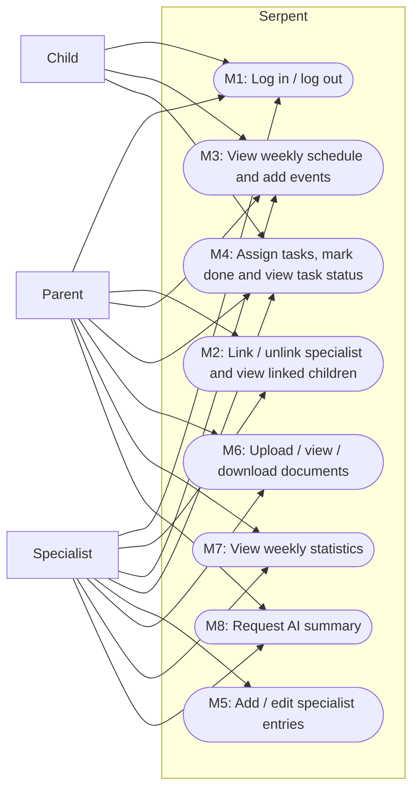

# Software Requirements Specification (SRS)

**Team name:** Serpent (Group 11)  
**Version:** ☒ First version (Week 6) ☐ Final (Week 10)  
**Last updated:** 2026-11-08

---

## 1. Introduction

**Owner:** Giray (SCRUM-46)

**Purpose of the system:**  
Serpent is a web-based decision support platform that brings together the people who follow a child's development (parents, teachers, psychologists, doctors, special education teachers and coaches) around one shared weekly schedule, task list and record of observations. An AI component summarizes the week's records for each reader according to their role. The AI only supports decisions: every summary is labelled "AI-generated", is linked to the records it is based on, and a human decides what to do.

**Users of the system:**

| User type | Description |
|---|---|
| Parent | Owns the child's data. Sees all of the child's records, links and unlinks specialists, adds events and tasks, uploads documents and reads the parent version of the AI summary. |
| Specialist | A teacher, psychologist, doctor, special education teacher or coach. Works only with the children they are currently linked to: adds events, tasks and dated entries, uploads documents and reads the specialist version of the AI summary. |
| Child | Sees only their own tasks and weekly schedule, and marks their tasks as done. Cannot see specialist entries, documents, statistics or AI summaries. |

Roles come from the account; a user does not choose a role at login. All data in the system is synthetic and created by a seed script.

**Definitions**

- **Week:** Monday 00:00 to Sunday 23:59, identified by the date of its Monday.
- **Development area:** one of *Language*, *Motor*, *Cognitive*, *Social-emotional*, *Self-care*.
- **Linked specialist:** a specialist who currently has a link to the child (created by the parent and not removed).
- **Entry:** a dated observation written by a specialist about a child.
- **Priority:** **Must** (required for v1.0), **Should** (planned), **Could** (only after all eight modules pass).

---

## 2. Functional Requirements

### M1 – Login and Roles

**Owner:** İlker (SCRUM-79)

| ID | Requirement | Priority |
|---|---|---|
| FR-M1-01 | The system shall allow a registered user to log in with email and password. | Must |
| FR-M1-02 | The system shall reject a login with a wrong email or password, show an error message that does not say which of the two was wrong, and issue no token. | Must |
| FR-M1-03 | The system shall take the user's role (parent, specialist or child) from the account; the login screen shall not let the user choose a role. | Must |
| FR-M1-04 | The system shall open the home screen of the user's role after a successful login (parent: weekly dashboard, specialist: list of linked children, child: my tasks). | Must |
| FR-M1-05 | The system shall show each role only its own screens and menu items; opening a screen of another role shall redirect the user to their own home screen. | Must |
| FR-M1-06 | The system shall keep the user logged in across page refreshes until the token expires or the user logs out. | Should |
| FR-M1-07 | The system shall allow a logged-in user to log out, after which protected screens are not accessible without logging in again. | Must |
| FR-M1-08 | The system shall provide a seed script that creates synthetic demo accounts for each role, a child, links and sample records. | Should |
| FR-M1-09 | The login screen shall offer demo account buttons that fill in the credentials of a seeded account. | Could |

### M2 – Linking Specialists

**Owner:** Giray (SCRUM-46)

| ID | Requirement | Priority |
|---|---|---|
| FR-M2-01 | The system shall allow a parent to link a registered specialist to their child by entering the specialist's email address and specialist type (teacher, psychologist, doctor, special education teacher or coach). | Must |
| FR-M2-02 | The system shall reject a link request, show an error message and create no link when the email does not belong to a registered specialist account. | Must |
| FR-M2-03 | The system shall list the specialists linked to a child, with name, email and specialist type, on the parent's "Linked specialists" screen. | Must |
| FR-M2-04 | The system shall allow a parent to unlink a specialist from their child only after the parent confirms the action. | Must |
| FR-M2-05 | The system shall check, on every API request about a child, that a specialist is currently linked to that child, and shall return an error (HTTP 403) and no child data otherwise, even if the specialist's login token is still valid. | Must |
| FR-M2-06 | The system shall allow only the child's parent to link or unlink specialists; such requests from a specialist or a child shall be rejected with HTTP 403. | Must |
| FR-M2-07 | The system shall show a specialist the list of children they are currently linked to. | Must |
| FR-M2-08 | The system shall reject linking a specialist who is already linked to the same child and show an error message. | Should |

### M3 – Weekly Schedule

**Owner:** Rahman (SCRUM-80)

| ID | Requirement | Priority |
|---|---|---|
| FR-M3-01 | The system shall allow a parent or a linked specialist to add an event to a child's schedule with a title, date, start time, end time and an optional description. | Must |
| FR-M3-02 | The system shall not save an event that has no title or whose end time is not later than its start time, and shall show an error message. | Must |
| FR-M3-03 | The system shall display the events of a selected week in a weekly view, grouped by day from Monday to Sunday and sorted by start time. | Must |
| FR-M3-04 | The system shall open the weekly view on the current week and let the user go to the previous or next week. | Should |
| FR-M3-05 | The system shall show a child their own weekly schedule and upcoming events in read-only mode, without add, edit or delete options. | Must |
| FR-M3-06 | The system shall allow only the user who created an event to edit or delete it. | Should |
| FR-M3-07 | The system shall provide a monthly view of the schedule. | Could |

### M4 – Tasks

**Owner:** Kerem (SCRUM-66)

| ID | Requirement | Priority |
|---|---|---|
| FR-M4-01 | The system shall allow a parent or a linked specialist to assign a task to a child with a title, description, development area and due date. | Must |
| FR-M4-02 | The system shall reject a task without a title, development area or due date, and show an error message. | Must |
| FR-M4-03 | The system shall create every new task with the status "pending" and record who assigned it. | Must |
| FR-M4-04 | The system shall show a child the list of their own tasks with title, description, due date and status. | Must |
| FR-M4-05 | The system shall allow a child to mark their own pending task as done and shall record the completion time. | Must |
| FR-M4-06 | The system shall show the assigner (parent or linked specialist) the tasks they assigned to a child, with the current status of each task. | Must |
| FR-M4-07 | The system shall show a parent all tasks of their child, whoever assigned them. | Must |
| FR-M4-08 | The system shall allow the assigner to create a recurring task (e.g. daily or weekly). | Could |

### M5 – Specialist Entries

**Owner:** Kerem (SCRUM-66)

| ID | Requirement | Priority |
|---|---|---|
| FR-M5-01 | The system shall allow a linked specialist to add an entry about a child with a date and text, and an optional development area. | Must |
| FR-M5-02 | The system shall show the parent and the linked specialists the child's entries, newest first, with date, author name and specialist type. | Must |
| FR-M5-03 | The system shall allow only the author of an entry to edit it; edit requests from other users shall be rejected with HTTP 403. | Must |
| FR-M5-04 | The system shall mark an entry that has been changed after creation as "edited", together with the time of the last edit. | Must |
| FR-M5-05 | The system shall not show entries to the child; entry requests from a child account shall be rejected with HTTP 403. | Must |
| FR-M5-06 | The system shall keep and show the full edit history of an entry. | Could |

### M6 – Documents

**Owner:** Rasül (SCRUM-82)

| ID | Requirement | Priority |
|---|---|---|
| FR-M6-01 | The system shall allow a parent or a linked specialist to upload a document about a child as a PDF, JPEG or PNG file. | Must |
| FR-M6-02 | The system shall reject files of unsupported types or files larger than 10 MB and show an error message. | Must |
| FR-M6-03 | The system shall list the child's documents with file name, file type, uploader and upload date for the parent and linked specialists. | Must |
| FR-M6-04 | The system shall allow the parent and linked specialists to view a document in the browser and download it. | Must |
| FR-M6-05 | The system shall not show documents to the child; document requests from a child account shall be rejected with HTTP 403. | Must |
| FR-M6-06 | The system shall allow the uploader to choose which linked specialists can see a document. | Could |

### M7 – Weekly Statistics

**Owner:** Rasül (SCRUM-82)

| ID | Requirement | Priority |
|---|---|---|
| FR-M7-01 | The system shall allow the parent and linked specialists to select a week for the child's statistics; the current week shall be selected by default. | Must |
| FR-M7-02 | The system shall show the task completion rate for the selected week as a percentage: tasks with a due date in that week and status "done", divided by all tasks with a due date in that week. | Must |
| FR-M7-03 | The system shall show the completion rate of the selected week separately for each development area that has at least one task in that week. | Must |
| FR-M7-04 | The system shall show "No tasks this week" instead of a percentage when the selected week has no tasks. | Should |
| FR-M7-05 | The system shall not show weekly statistics to the child. | Should |

### M8 – Role-based AI Summary

**Owner:** Rahman (SCRUM-80)

| ID | Requirement | Priority |
|---|---|---|
| FR-M8-01 | The system shall allow a parent or a linked specialist to request an AI summary of a child's records for a selected week. | Must |
| FR-M8-02 | The system shall send to the AI service only the records of the selected week that the requesting user is allowed to see (tasks with their status, events and entries), without names, email addresses or other account data. | Must |
| FR-M8-03 | The system shall use a different prompt for each reader: everyday, simple language for parents and short, professional language for specialists. | Must |
| FR-M8-04 | The system shall display every summary with an "AI-generated" label and links to the records the summary is based on. | Must |
| FR-M8-05 | The prompts shall tell the AI to use only the given records, to state when information is missing, and never to make decisions or suggest a diagnosis or treatment. | Must |
| FR-M8-06 | The system shall let the reader mark a summary as "helpful" or "incorrect" and shall save this feedback. | Must |
| FR-M8-07 | The system shall show an error message when the AI service is not available, while all other functions keep working. | Must |
| FR-M8-08 | The system shall not show AI summaries to a child; summary requests from a child account shall be rejected with HTTP 403. | Must |
| FR-M8-09 | The system shall suggest new tasks based on the week's records as pending suggestions that a human must accept or reject. | Could |

---

## 3. Non-Functional Requirements

**Owner:** Giray (SCRUM-46)

| ID | Category | Requirement |
|---|---|---|
| NFR-01 | Security | Passwords are stored only as bcrypt hashes; no API response or log contains a password or password hash. |
| NFR-02 | Security | Every API endpoint except login and health requires a valid JWT and returns HTTP 401 without one; every endpoint about a child additionally checks the user's access to that child (parent of the child, currently linked specialist, or the child themself) and returns HTTP 403 otherwise. Verified by API tests for each child endpoint. |
| NFR-03 | AI safety | The AI module receives only records the requesting user is allowed to see, its prompts forbid diagnosis and treatment suggestions, and every summary is shown with the "AI-generated" label and links to its source records. |
| NFR-04 | Testability | The AI module has a mock mode that returns a fixed summary without any network call; all automated tests and the CI pipeline run in mock mode and pass without an API key. |
| NFR-05 | Performance | With the seed data on a developer laptop, each API request responds in under 500 ms and each page loads in under 2 seconds (excluding the time of a real AI call). |

---

## 4. Critical Flows and Acceptance Criteria

**Owner:** Rasül (SCRUM-82). The same three flows are shown as sequence diagrams in SDD Section 5 and will each have an end-to-end test.

| Flow | Related requirements | Acceptance criteria |
|---|---|---|
| Flow 1: Login and role-based screens | FR-M1-01, FR-M1-02, FR-M1-03, FR-M1-04, FR-M1-05 | **Given** a seeded parent account and a seeded child account **When** the parent logs in with the correct email and password **Then** the parent's weekly dashboard is shown. **When** the child logs in **Then** only the "My tasks" screen and the child's menu are shown, and opening a parent screen redirects back to "My tasks". **When** a user enters a wrong password **Then** an error message is shown and the user stays on the login screen. |
| Flow 2: Parent links and unlinks a specialist; an unlinked specialist is denied access | FR-M2-01, FR-M2-02, FR-M2-03, FR-M2-04, FR-M2-05, FR-M2-07 | **Given** a logged-in parent and a registered specialist who is not linked to the child **When** the parent enters the specialist's email and type and saves **Then** the specialist appears in the parent's linked-specialists list and the child appears in the specialist's list of children. **When** the parent enters an unregistered email **Then** an error is shown and no link is created. **When** the parent unlinks the specialist and confirms **Then** the specialist's next request about the child returns HTTP 403 and no child data, although the specialist's token is still valid. |
| Flow 3: Specialist assigns a task, the child marks it done, the specialist sees the status | FR-M4-01, FR-M4-03, FR-M4-04, FR-M4-05, FR-M4-06 | **Given** a specialist linked to a child **When** the specialist assigns the task "Read for 20 minutes" with development area Language and a due date this week **Then** the child sees the task in "My tasks" with status "pending". **When** the child marks the task as done **Then** the specialist's list of assigned tasks shows the task with status "done". |

---

## 5. Use Case Diagram

**Owner:** Rasül (SCRUM-82)

---

## 6. Change Log

| Date | Change | By |
|---|---|---|
| 2026-11-06 | First version: skeleton, introduction, FR M2, non-functional requirements | Giray |
| 2026-11-07 | FR M4, M5 | Kerem |
| 2026-11-07 | FR M3, M8 | Rahman |
| 2026-11-07 | FR M6, M7, critical flows and acceptance criteria, use case diagram | Rasül |
| 2026-11-07 | FR M1 | İlker |
| 2026-11-08 | Consistency review: definitions, unified FR wording, guidance notes removed | Giray |
